

  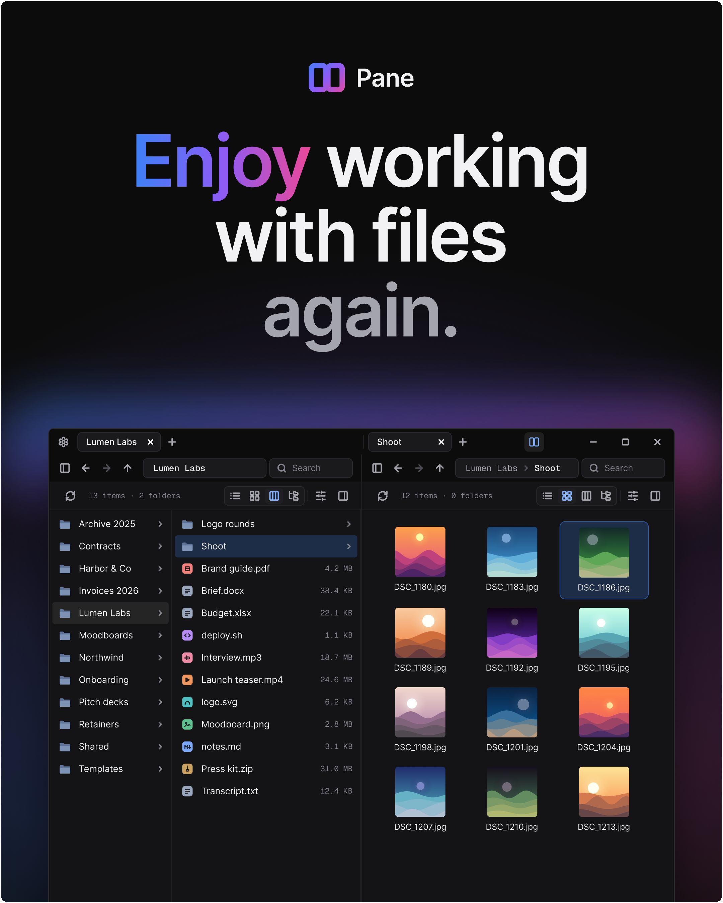

  <a href="https://github.com/cursive-machines/pane-releases/releases/latest"><b>Download Pane for Windows</b></a>
   
  Windows 10 and 11, 64-bit. Pane keeps itself up to date.

 

Pane is a file manager for Windows. It opens in a blink, keeps the folders you're working in one
click away in tabs or side by side, and lets you see each folder the way that suits it: as a list,
a grid of thumbnails, columns or a tree.

<picture>
  <source media="(prefers-color-scheme: dark)" srcset="assets/pane-list-dark.png">
  <source media="(prefers-color-scheme: light)" srcset="assets/pane-list-light.png">
  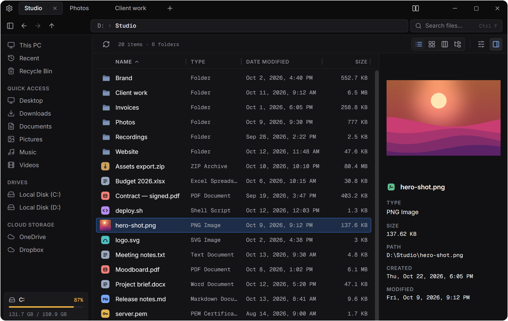
</picture>

Select a file and the details panel shows a preview with its type, size, full path and dates,
without opening anything.

## Look inside with Space

Press <kbd>Space</kbd> on a file to see it without opening it: photos, videos and music, PDFs page
by page, and text and code with line numbers. The arrow keys move to the next file and the preview
follows. <kbd>Enter</kbd> opens it, <kbd>Esc</kbd> closes the preview.

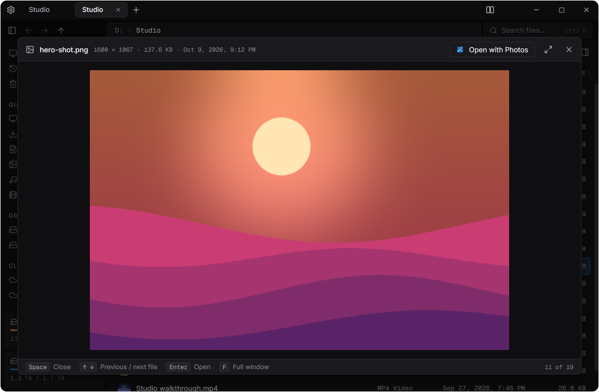

## Two folders at once

Open a second pane and work in two places side by side. Each pane has its own tabs and its own
view, and you can drag files from one to the other to move or copy them.

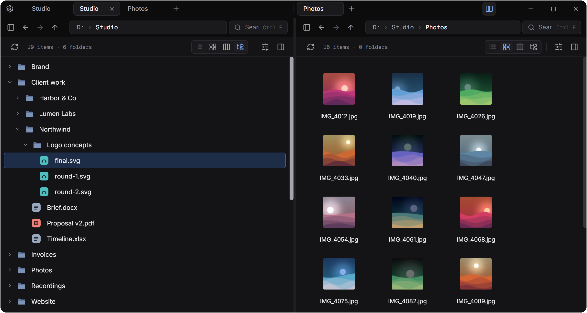

## Four ways to see a folder

Switch views from the toolbar. Pane remembers the view for each tab.

- **List** has sortable, resizable columns for name, type, date and size, and stays smooth in
  folders with thousands of files.
- **Grid** shows icons and thumbnails, at any size from compact to roomy.
- **Columns** opens each folder in a new column, so the whole path stays in view.
- **Tree** expands folders in place, as deep as you like.

<table>
  <tr>
    <td align="center"><b>List</b> 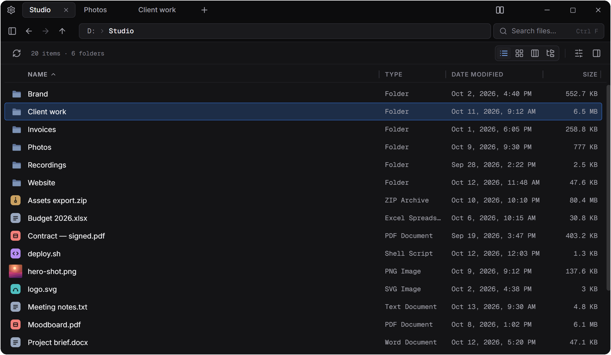</td>
    <td align="center"><b>Grid</b> 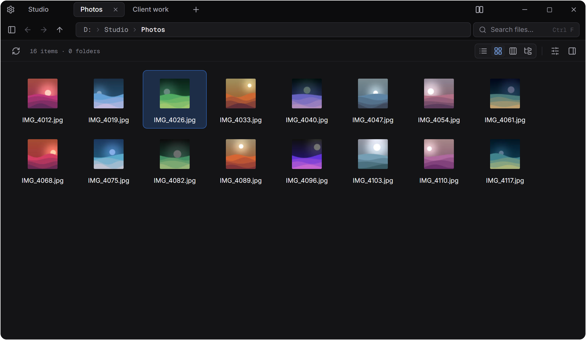</td>
  </tr>
  <tr>
    <td align="center"><b>Columns</b> 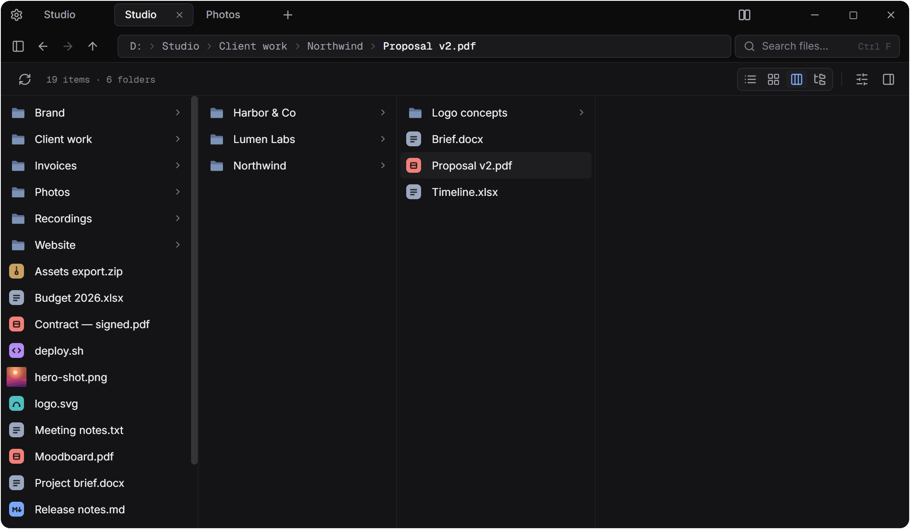</td>
    <td align="center"><b>Tree</b> 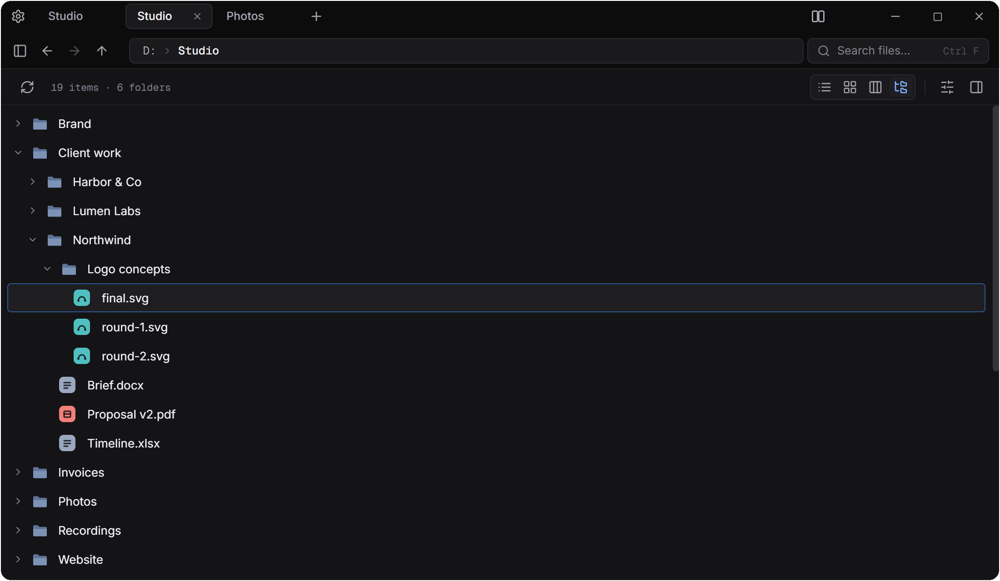</td>
  </tr>
</table>

## Thumbnails for photos and videos

Images and videos show a preview instead of a generic icon. Video frames come from the same
thumbnail service File Explorer uses, so there is nothing extra to install, and any format File
Explorer can preview, Pane can too.

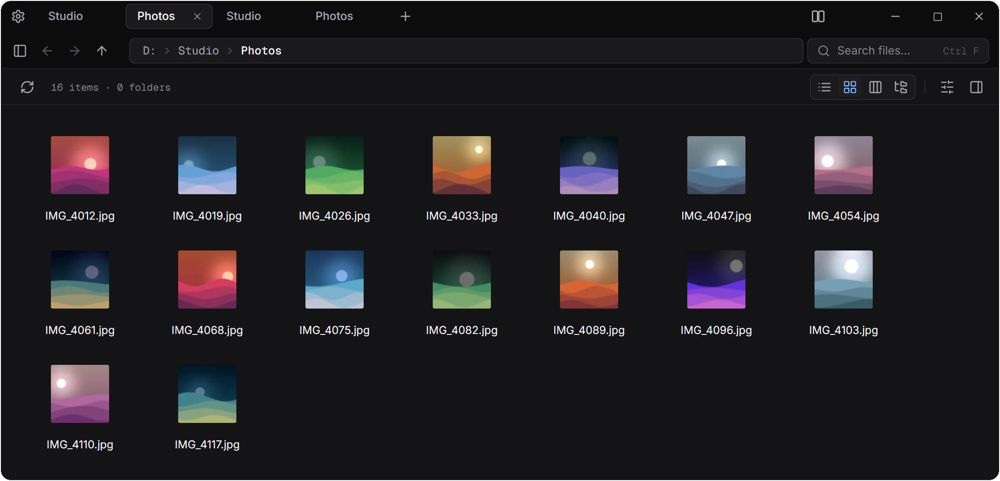

## Search as you type

Press <kbd>Ctrl</kbd>+<kbd>F</kbd> and start typing: results come in as you type, grouped into
exact, word and partial matches, each with its real icon. Filter to files or folders. Search from
This PC to look across every drive. Pane keeps a list of file names for each drive and updates it
as files change, so a search across the whole computer takes a moment, not minutes.

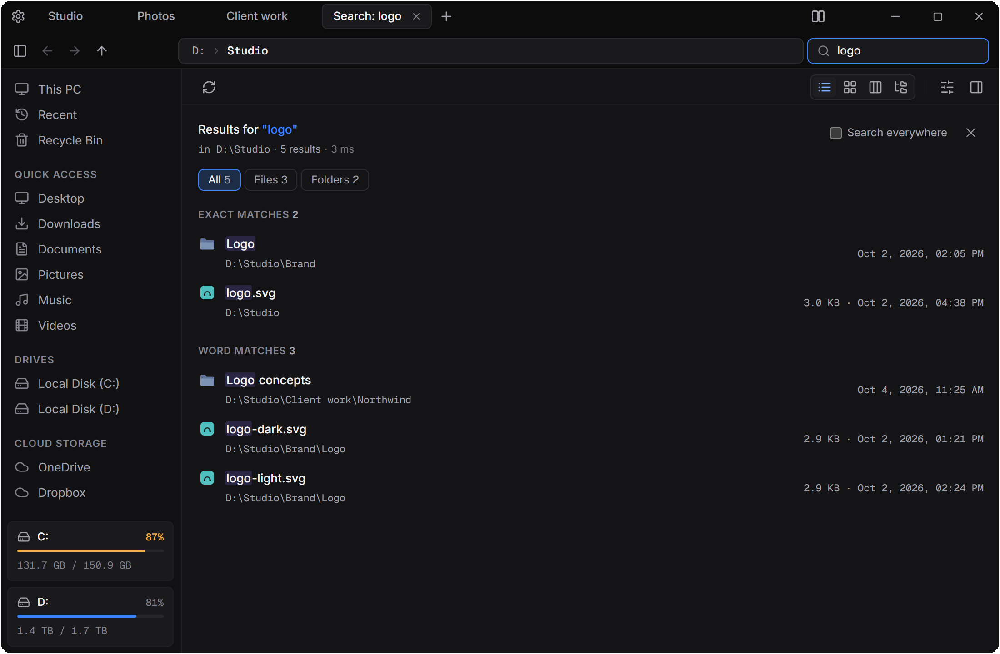

## Folders that stay current

Turn on folder sizes and the Size column shows how big every folder is. Pane works each size out
once, then keeps it up to date by watching for changes on the drive, so browsing stays fast.
When another app adds, renames or deletes files, the folder you're looking at updates by itself.
None of this needs administrator rights.

## Everyday file work

- **Copy, cut and paste** with <kbd>Ctrl</kbd>+<kbd>C</kbd>, <kbd>X</kbd> and <kbd>V</kbd>, through
  the Windows clipboard: copy in File Explorer and paste in Pane, or the other way round. Big copies
  run in the background with their progress and a Cancel button. When a name is taken, choose
  **Skip**, **Create a copy** or **Replace**, once or for the whole batch.
- **Undo** with <kbd>Ctrl</kbd>+<kbd>Z</kbd>: a delete comes back from the Recycle Bin where it
  was, and moves, copies, renames and new folders are reversed too.
- **Recycle Bin inside Pane**: <kbd>Del</kbd> moves files there, so nothing is lost by accident.
  Open **Recycle Bin** in the sidebar to restore them or delete them for good.
- **The Windows menu too**: right-click → **More options** shows the commands other apps add,
  such as Send to, Defender or your archiver. Drag the ones you use into the menu to keep them
  there.
- **Drag and drop** between panes, tabs and the sidebar, and to or from other apps: drop files
  from a browser into Pane, or from Pane into an email. Drop folders between Quick Access rows to
  put them exactly there.
- **Archives**: double-click a ZIP or TAR file to extract it, or right-click files to make a ZIP.
- **Address bar** that understands `%APPDATA%`, `~`, `shell:startup` and names like Downloads.
- **Sidebar** with Recent, the Recycle Bin, your quick-access folders, every drive with its free space, and
  OneDrive and Dropbox.

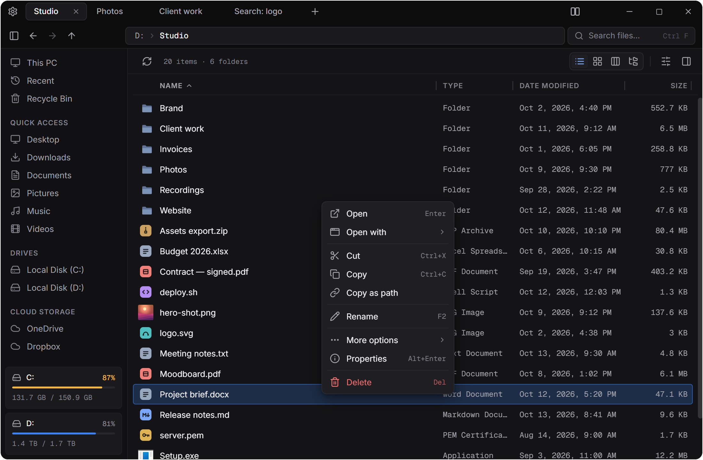

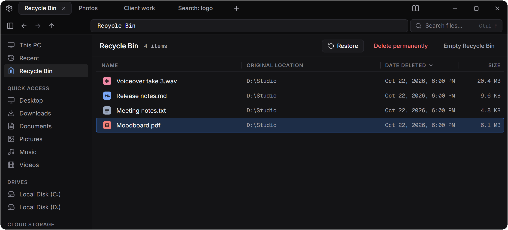

## Make it yours

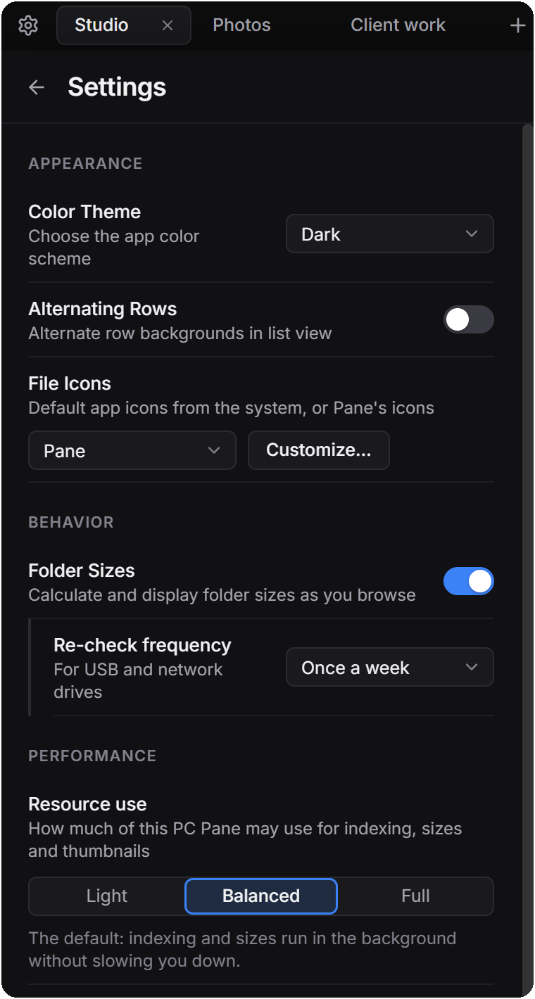

- **Dark, light or dark with vibrancy**, which lets your Windows desktop show softly through the
  window.
- **Zoom** the whole interface with <kbd>Ctrl</kbd>+<kbd>+</kbd> and <kbd>Ctrl</kbd>+<kbd>−</kbd>;
  <kbd>Ctrl</kbd>+<kbd>0</kbd> resets it.
- **File icons** from Windows, matching the app that opens each file, or Pane's own set. Choose
  for each kind of file in one dialog.
- **Light, Balanced or Full**: choose how much of your PC Pane may use for indexing, folder sizes
  and thumbnails.
- **Alternating rows** in the list, if you like stripes.
- Your tabs, panes, views and window size are all there next time you open Pane.

 

## A short tour to start

The first time you open Pane, a short tour walks through what it can do, and every step is live:
type a search, open folders in each view, open a second pane and drag a file across, peek with
<kbd>Space</kbd>, delete and undo, and pick your theme. Skip it any time; it's in Settings → About
whenever you want it again.

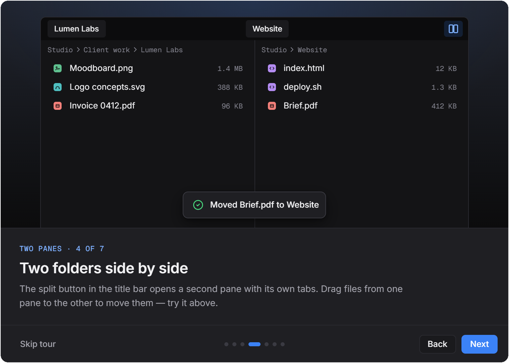

## Keyboard shortcuts

| Shortcut | Does |
|---|---|
| <kbd>Ctrl</kbd>+<kbd>T</kbd> | New tab |
| <kbd>Alt</kbd>+<kbd>←</kbd> / <kbd>Alt</kbd>+<kbd>→</kbd> | Back / forward (the mouse's side buttons work too) |
| <kbd>Alt</kbd>+<kbd>↑</kbd> | Up to the parent folder |
| <kbd>Enter</kbd> | Open |
| <kbd>Space</kbd> | Preview (Quick Look) |
| <kbd>F2</kbd> | Rename |
| <kbd>Del</kbd> | Move to the Recycle Bin |
| <kbd>Shift</kbd>+<kbd>Del</kbd> | Delete permanently (asks first) |
| <kbd>Ctrl</kbd>+<kbd>A</kbd> | Select all |
| <kbd>Ctrl</kbd>+<kbd>C</kbd> / <kbd>X</kbd> / <kbd>V</kbd> | Copy / cut / paste |
| <kbd>Ctrl</kbd>+<kbd>Shift</kbd>+<kbd>C</kbd> | Copy as path |
| <kbd>Ctrl</kbd>+<kbd>Z</kbd> | Undo |
| <kbd>Alt</kbd>+<kbd>Enter</kbd> | Properties |
| <kbd>Ctrl</kbd>+<kbd>F</kbd> | Search |
| <kbd>Ctrl</kbd>+<kbd>+</kbd> / <kbd>−</kbd> / <kbd>0</kbd> | Zoom in / out / reset |

## Install

1. Download `Pane_<version>_x64-setup.exe` from the
   [latest release](https://github.com/cursive-machines/pane-releases/releases/latest).
2. Run it and follow the installer.

Pane checks for a new version when it starts (or when you click **Check for updates** in
Settings → About). When one is ready, it asks before installing it, and the first start after an
update shows what's new.

**Requirements:** Windows 10 or 11, 64-bit (x64).

## Feedback

Found a bug, or missing something you use every day?
[Open an issue](https://github.com/cursive-machines/pane-releases/issues) and tell us what
happened and what you expected.

 

Pane is made by Cursive Machines.

